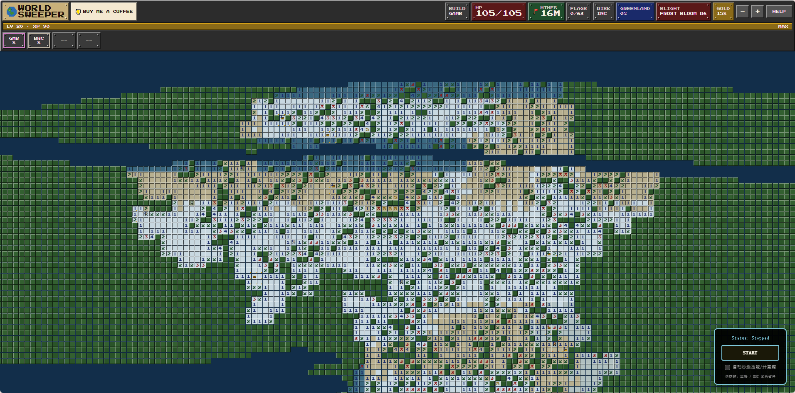
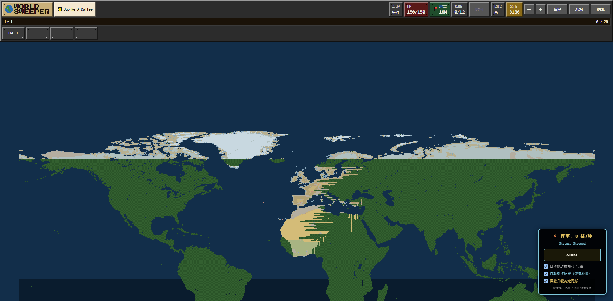

## 🎮 关于 WorldSweeper 游戏 (About the Game)

[WorldSweeper](https://worldsweeper.site) 是一款将**经典扫雷**与**真实地球地理、Roguelite RPG 角色养成**深度融合的创新网页游戏。

不同于传统扫雷“踩雷即暴毙”的严苛规则，WorldSweeper 引入了生命值、护甲、职业技能树与局外养成系统，玩家将在由数千万像素点构成的真实世界地图上展开探索与征服。

---

### 🌟 核心玩法机制

- 🗺️ **全球真实地理与国家征服 (World Map Conquest)**  
  游戏地图基于真实地球地形构建（尺寸高达 `25088 × 12544`）。当玩家翻开一个国家 **80%** 的安全地块时即可成功征服该国；征服大洲内的所有国家后，将解锁整个大洲的征服成就与丰厚赏金。
- ❤️ **生命值与容错机制 (HP & Armor System)**  
  踩中地雷不会立即导致游戏失败，而是扣除相应生命值（受护甲与减伤影响）。玩家可以通过升级回血、技能吸收伤害或利用拆弹套件（Defuse Kits）安全排雷。
- 🚩 **动态旗帜上限与双击连锁 (Flag Limit & Chording)**  
  玩家拥有固定上限的旗帜容量，不可无脑全图插旗，需合理拔旗与复用；当数字周围标记的旗帜数与雷数匹配时，点击数字可触发 **连锁开辟（Chording）**。

---

### ⚔️ 五大特色初始职业 (Starter Builds)

| 职业名称 | 定位与特色 | 核心初始技能 | 优势与权衡 |
| :--- | :--- | :--- | :--- |
| **Scout (侦察兵)** | 视野感知 / 探图先锋 | `Pulse (主动脉冲)` | 探测大范围隐藏地雷；生命值较低，容错率较低 |
| **Demolitionist (爆破手)** | 强力连锁 / 高风险清图 | `Overload (被动过载)` | 翻开地块时产生连锁爆破与大范围开辟；初始旗帜较少 |
| **Technician (技师)** | 稳健排雷 / 战术大师 | `Defuse (主动拆弹)` | 消耗拆弹套件直接安全排雷，排雷成功可回收套件；推图节奏偏稳 |
| **Gambler (赌徒)** | 概率博弈 / 极高收益 | `Gamble (主动赌博)` | 概率直接无损探开盲区地块，额外金币与经验加成；防御与生命极低 |
| **Survivor (幸存者)** | 坚韧生存 / 新手推荐 | `Brace (被动格挡)` | 吸收高额地雷伤害，翻开数字地块获得生命回复；推图收益较低 |

---

### 🗺️ 双模式设计 (Game Modes)

- 🎲 **经典模式 (Classic Mode)**：单局独立探索，每次死亡或重开都会生成全新的随机世界与种子。
- 🏰 **战役模式 (Campaign Mode)**：**地图持久化保留**。角色死亡后已翻开的地块、征服进度与已开启的宝箱均会永久保留，玩家可更换新职业在原有世界地图上继续推进。

---

### 🏛️ 地图特殊地块与交互机制 (Field Hazards & POIs)

随着探索深入，地图上会随机生成与生物群系相关的特殊事件地块：

- 🎁 **宝箱 (Treasure Chest)**：提供金币、经验、被动词条与稀有装备，部分宝箱可能会伪装成**宝箱怪（Mimic）**造成伤害。
- 🌋 **金币喷口 (Gold/Steam Vent)**：消耗少量生命值进行排气，直接获取大量金币与经验。
- ⛩️ **神殿 (Shrine)**：通过献祭生命换取强力增益，提供 **透视周边地雷 (Sight)**、**财富抽取 (Fortune)** 或 **临时护甲祝福 (Ward)**。
- 🥀 **枯萎之花 (Blight Bloom)**：危险地块，若翻开后未及时使用工具封印，苏醒后将对周边区域持续造成范围伤害。

---

## 📖 项目简介 (Overview)

**WorldSweeper_Auto_Script** 是一款专为网页端游戏 [WorldSweeper](https://worldsweeper.site) 打造的高性能全自动用户脚本（Userscript）,是基于宿主游戏底层确定性哈希逆向与 React Fiber 自动捕获的全自动、全知级扫雷与宝藏收割机器人。

不同于基于概率推测、局部爬行或单线程 DOM 模拟点击的扫雷 AI，本项目通过完全逆向游戏底层的 **确定性伪随机哈希算法（Deterministic PRNG Hashing）** 与 **生物群系特征分布（Biome Multipliers）**，实现了对全图地块的 100% 绝对预测。项目引入了 **WebGPU 计算着色器（WGSL Compute Shader）** 与 **MessageChannel 连续微任务管道**，将计算直接卸载至用户的 **AMD / Intel / NVIDIA 显卡** 数千个硬件流处理器上并发推演。在保证绝对避雷、自动秒退神殿与视口完全解离的前提下，实现了从传统 **200 格/秒** 到 **100,000 ~ 500,000+ 格/秒** 的数量级性能跨越。
---

## ✨ 核心特性 (Key Features)

- 🎮 **WebGPU 显卡硬件级并发加速 (GPGPU Parallel Acceleration)**
  - 编写原生 WGSL 计算着色器，将地图数据推送至显存（VRAM），单批次并发调度 **150,000+** 显卡流处理器核心。
  - 内置 CPU 超频降级通道（100KB $X$ 轴哈希预查表 + $Y$ 轴行级缓存），在不支持 WebGPU 的环境下自适应平滑回退。
- 🧬 **React 19 Fiber 全自动状态嗅探 (Zero-Config Auto-Extraction)**
  - 内置 Fiber 虚拟 DOM 树回溯探查器，毫秒级自动解包 `world` / `session` / `view`，**彻底告别 React DevTools 与控制台手动注入**。
- 🔮 **全知级逆向透视引擎 (Full Mathematical Oracle)**
  - 100% 精确推演地雷 (`Mine`)、宝箱 (`Treasure Chest`)、金币喷口 (`Gold Vent`)、神殿 (`Shrine`) 与枯萎之花 (`Blight Bloom`)。
  - 完美复刻 12 种生物群系（海洋、草地、沙漠、火山等）生成权重与倍率修正。
- ⚡ **视口操作完全物理隔离 (Viewport Decoupling - Zero Shaking)**
  - 彻底剥离扫描算法与玩家镜头视野的耦合。玩家可随意缩放、平移拖动视口，**无任何画面抖动、掉帧或卡死**。
- 📊 **实时每秒开辟速率仪表盘 (Real-Time Speedometer)**
  - 400ms 高精度动态滑动窗口采样，控制面板实时展示当前 `⚡ 速率: X 格/秒`。
- 🛡️ **神殿无损秒退与喷口自残熔断 (Self-Damage Protection)**
  - 遇到神殿 100% 自动点击“Walk away”安全离开，杜绝献祭扣血；喷口增加 60% 血量安全阈值，防止低血量自残暴毙。
- 🏆 **国家征服弹窗自动继续 (Auto Keep-Playing)**
  - 达成国家 80% 征服阈值时，自动触发“Keep playing”秒关弹窗，全自动跨大洲连续推进。
- 🕶️ **屏蔽升级全屏黄光爆闪 (Anti-Flash Filter)**
  - 动态注入 CSS 规则拦截 `.hud-flash-level`，彻底消除超高频升级时的刺眼黄色频闪。
- 🛑 **零延迟即按即停与全局急停 (Zero-Latency Emergency Brake)**
  - 采用 `pointerdown` 监听替代传统 `click`，按下瞬间中断调度；全局支持 **`Space`（空格）** 或 **`ESC`** 瞬时急停。

---

## 🏗️ 架构与分层设计 (Architecture)

项目遵循 **SOLID** 原则与模块化解耦规范，采用纯原生 JavaScript (ES2022) + WGSL 开发，分层如下：

```text
┌────────────────────────────────────────────────────────────────────────┐
│                        WorldSweeperBot (主控应用)                       │
│       (生命周期管理 · 状态机维护 · 键盘热键绑定 · 异步双流调度)              │
└────────────┬──────────────────────────────────────────┬────────────────┘
             │                                          │
    ┌────────▼─────────┐                       ┌────────▼─────────┐
    │ GameStateAdapter │                       │   UIController   │
    │(Fiber自动状态提取)│                       │ (悬浮窗与速率监测)│
    └────────┬─────────┘                       └──────────────────┘
             │
    ┌────────▼──────────────────────────────────────────────────────────┐
    │                     WebGPUSweeperEngine                           │
    │  (WebGPU WGSL 显卡并行流水线 / 100KB 预查表 CPU 超频降级引擎)        │
    └────────┬──────────────────────────────────────────┬───────────────┘
             │                                          │
    ┌────────▼─────────┐                       ┌────────▼─────────┐
    │ FullOracleEngine │                       │CanvasInputDispatcher│
    │(底层哈希逆向计算)│                       │ (宝箱交互事件代理)  │
    └──────────────────┘                       └──────────────────┘
```

### 核心模块职责说明

| 模块名称 | 职责定位 | 核心方法 / 特性 |
| :--- | :--- | :--- |
| **`WebGPUSweeperEngine`** | GPGPU / CPU 计算调度层 | `sweepGpuBatch()`（显存直算）、`sweepCpuFallback()` |
| **`FullOracleEngine`** | 纯数学计算层 | `hashMine()`, `hashTreasure()`, `getCountryId()` |
| **`GameStateAdapter`** | 宿主交互与 Fiber 提取 | `autoCaptureFiberState()`、`resolveHealth()`、`handleModals()` |
| **`CanvasInputDispatcher`**| 输入代理 | `dig()`（坐标逆运算精准开箱，不篡改视口） |
| **`UIController`** | 交互面板与防频闪 | `mount()`, `setSpeed()`, `setAntiFlashEnabled()`, `setStatus()` |
| **`WorldSweeperBot`** | 核心主控与状态机 | `start()`, `stop()`, `processGpuWork()`, `startUiAndModalLoop()` |

---

## 🧬 React Fiber 自动捕获原理 (Automated Fiber Extraction)

游戏基于 **React 19** 构建，函数式组件内的状态被封装在闭包与 Fiber 虚拟节点中。脚本内置了自动状态嗅探器，工作原理如下：

```text
DOM 渲染树                  Fiber 虚拟节点链表                    运行时状态挂载
[ <canvas> ] 
     │
     └──> 读取 __reactFiber$ 私有属性
               │
               └──> 向上回溯父级 Fiber 节点 (node.return)
                         │
                         └──> 遍历 hook 链表 (memoizedState)
                                   │
                                   ├── hook.memoizedState.current (useRef) ──> 提取 world / session / view
                                   └── hook.memoizedState[0] (useState)   ──> 提取 meta
                                             │
                                             └──> 自动挂载至 unsafeWindow.__GAME (Ready!)
```

---

## ⚙️ 底层逆向算法与 WebGPU 着色器 (Algorithms & WebGPU)

### 1. 核心 32 位整数混淆函数 (`hashU32`)

```javascript
/**
 * 32位无符号整数位混淆器
 * @param {number} value - 待混淆的整数输入
 * @returns {number} 0 ~ 4294967295 范围的伪随机无符号整数
 */
function hashU32(value) {
    let t = value | 0;
    t = Math.imul(t ^ (t >>> 16), 2146121005); // 阶段1：异或高16位后乘以质数
    t = Math.imul(t ^ (t >>> 15), 2221713035); // 阶段2：异或高15位后乘以质数
    return ((t ^ (t >>> 16)) >>> 0);           // 阶段3：无符号右移转为 U32
}
```

---

## 🚀 快速上手 (Quick Start)

### 1. 前置准备
安装支持 Userscript 的现代浏览器扩展：
- [Tampermonkey (篡改猴)](https://www.tampermonkey.net/)
- [Violentmonkey (暴力猴)](https://violentmonkey.github.io/)

### 2. 安装与运行
1. 打开 Tampermonkey 管理面板，点击 **新建脚本 (+)**。
2. 复制项目源码中的 `WorldSweeper.user.js` 并粘贴保存。
3. 打开 [https://worldsweeper.site/](https://worldsweeper.site/) 选择任意职业进入游戏。
4. **完全无需手动操作**，脚本自动完成 Fiber 捕获并激活 WebGPU 显卡引擎。
5. 当右下角面板显示 `Status: Ready` 时，点击 **`START`** 或按下 **`空格键`** 即可开启超光速秒图！

---

## 🎮 界面与快捷键说明 (Controls & UI Panel)

| 操作方式 | 对应功能 | 说明 |
| :--- | :--- | :--- |
| **`Space`（空格键）** | **紧急暂停 / 继续** | 全局热键，敲击瞬间 1ms 内硬性中断主循环 |
| **`ESC`（退出键）** | **紧急暂停 / 继续** | 与空格键功能相同 |
| **鼠标点击 `Stop`** | **停止运行** | 采用 `pointerdown` 监听，光标按下即停，绝不漏点 |
| **☑ 自动秒选技能/开宝箱** | **全自动挂机** | 自动选择升级技能、自动开启宝箱并拾取战利品 |
| **☑ 自动继续征服 (国家弹窗秒退)** | **大洲收割** | 达成国家 80% 征服后，0ms 自动秒选 "Keep playing" 继续推图 |
| **☑ 屏蔽升级黄光闪烁** | **防频闪保护** | 过滤全屏黄色高光动画遮罩，防止高速升级时屏幕剧烈爆闪 |

---

## 🔧 运行配置项说明 (Configuration)

如需调整参数，可直接修改脚本顶部的 `CONFIG` 对象：

```javascript
const CONFIG = Object.freeze({
    GPU_BATCH_SIZE: 150000,        // 单次 WebGPU 显卡并发调度的地块规模 (15万格/批次)
    MICRO_CHUNK_TILES: 25000,      // CPU 降级模式下单微任务吞吐上限
    SAFE_HP_RATIO_FOR_VENT: 0.60,  // 生命值高于 60% 时才允许点击喷口
    SPEED_SAMPLE_INTERVAL_MS: 400, // 速率采样统计周期 (毫秒)
    UI_THROTTLE_MS: 150,           // UI 文本渲染节流周期 (毫秒)
});
```

---

## 🛠️ 代码规范与静态检查 (Code Quality)

本项目遵循严格的工业级开源标准：
- **ESLint 0 告警**：通过严格的 `no-undef`, `no-multi-spaces`, `no-bitwise`, `no-redeclare` 等规则。
- **全量 JSDoc 注解**：类、静态方法、函数入参及返回值均具备规范类型标注。
- **作用域完全隔离**：严格的沙箱作用域隔离，不污染宿主全局变量。

---

## 📜 免责声明 (Disclaimer) & License

本项目仅供前端自动化测试、WebGPU 并行计算与逆向工程学术研究使用。请合理使用本脚本，请勿用于破坏在线竞技排名的公平性。

本项目基于 [MIT License](LICENSE) 协议开源。